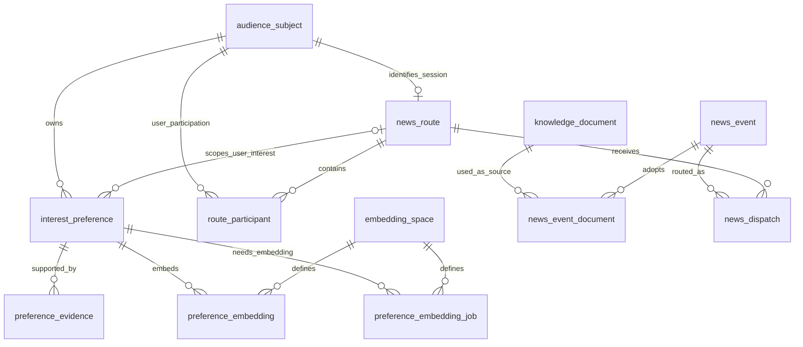

# 用户偏好与新闻分发数据库设计草案

状态：只设计，尚未执行建表、修改运行时或连接数据库。现有 Librarian 提示词修改保留。用户偏好只在统一 leading 阶段整理；原 MySQL 文档归档纳入 PostgreSQL 迁移范围。

## 目标与流程

新闻抓取 → Librarian 筛选、核查与事件整理 → 现有知识库入库 → 事件匹配偏好 → 按群合并命中 → 驱动消息 → 主智能体回复。

每条新闻统一研究一次，不为每个群重新研究。AIChat 的文档正文、偏好、来源依据、群聊路由和新闻分发状态统一存 PostgreSQL，并共用一个 HikariDataSource。现有 Qdrant 继续管理记忆向量与知识检索向量，本次不扩大到这两类向量的存储迁移。

用户已选择 `qwen3.7-text-embedding-flash`。官方模型页列出的默认维度为 1024，支持 256、512、768、1024。本草案采用 1024 维稠密向量、余弦距离和 pgvector HNSW 索引。

建表草案见 [news-preferences-schema.sql](news-preferences-schema.sql)，目标 PostgreSQL 15+，需要安装 pgvector 扩展。尚未在数据库执行，约束与索引仍需实际 PostgreSQL 验证。

## 表与关系

| 表 | 作用 | 关键关系 |
| --- | --- | --- |
| knowledge_document | 从 MySQL 迁移的文档归档 | 保留原 id，维持现有 Qdrant document_id 关联 |
| audience_subject | 用户或会话的偏好归属 | 用户用 Account.LocationId，会话用实际全局 SessionId |
| news_route | 推送目标及开关、频率、安静时段 | 一个会话主体对应一个真实发送目标 |
| route_participant | 用户参与哪些群聊或私聊 | 用户主体与实际会话之间的多对多关系 |
| interest_preference | 一条原子偏好的当前结论 | 主体、适用会话、话题、喜欢/排除、强度、置信度、依据类型 |
| preference_evidence | 偏好来自哪些消息或人工设置 | 多条证据支持一条偏好，也保留更正、撤回依据 |
| embedding_space | 向量模型与语义空间版本 | 模型、版本、维度、输入规则不可混用 |
| preference_embedding | 偏好检索向量 | 同一偏好可按不同空间重建；旧内容版本不能参与匹配 |
| preference_embedding_job | 偏好内容变更后的向量构建与重试 | 与偏好变更同事务入队，不做额外的偏好提取 |
| news_event | Librarian 整理后的事件 | 分类、主题、适用读者、来源、版本、核查与筛选状态 |
| news_event_document | 事件与归档文档之间的关系 | 同一事件可能采用多个来源；同一文档可以服务多个事件 |
| news_dispatch | 按群合并的分发记录 | 同一事件版本对同一会话唯一；保存决策与消息快照 |

其中七张表管理偏好及范围，一张表维护偏好向量构建任务；文档归档和新闻分发复用同一数据库，不另建数据源。

## 偏好字段的语义

`interest_preference` 每行表示一个明确话题或实体的偏好。例如“关注本地部署大模型，特别在意显存需求和开源许可证”，而不是整个人的一段笼统画像。

| 字段 | 含义 |
| --- | --- |
| subject_id / subject_type | 谁的偏好；用户与会话是不同主体 |
| scope_session_id | 用户偏好在哪个群适用；NULL 表示用户通用偏好，会话偏好不填写此字段 |
| preference_kind | topic / entity / content_type，例如技术方向、产品或公司、教程或论文 |
| topic_key | 经归一化的稳定键，如 ai.local_models，不把自然语言表述直接当唯一键 |
| topic_name / description | 可读主题和完整兴趣描述，用于向量化和驱动消息 |
| polarity | 1 表示关注，-1 表示排除；负向偏好不能因语义相似而变成正向候选 |
| strength | 关注或排除的强度，0 到 1；不能用聊天次数直接替代 |
| confidence | 对“存在此偏好”的确定程度，0 到 1；不等于兴趣强度 |
| origin | manual / explicit / inferred；人工设置或明确表达优先于推断 |
| global_news_use | 通用用户偏好是否明确允许参与所在群的新闻匹配，默认 false；不是人物身份关联授权 |
| status / valid_until | 是否仍有效；短期话题可到期，永久偏好不设置到期时间 |
| content_revision | 向量输入内容版本；主题、描述变化时增加，检索跳过旧向量 |
| record_revision | 当前偏好结论版本，用于两个整理阶段之间的并发更新校验 |
| last_confirmed_at | 最近明确确认的时间，不是每次检索时间 |

不把普通讨论、引用、反讽或对某条新闻的单次反应直接写成长期喜好。同一用户同一范围同一主题只有一条当前结论，多次提及保留多条 evidence，不重复创建 preference。

明确更正可以更新结论；模型推断不能覆盖人工设置或明确排除。用户在一个群的临时讨论，不自动扩大成全部群的通用偏好。同一个用户命中多个群，分别依据每个群的上下文和路由策略决定是否投递。

## 在统一 leading 中维护偏好

偏好提取复用 `AIChat.leading()` 的模型调用，不另建持续监听聊天的画像 Agent，也不交给新闻定时任务猜测用户偏好。运行时已统一 topic 批次的记忆维护与回复判断，删除了独立记忆生成阶段；偏好表及偏好操作仍是设计，尚未实现。

### 输入与输出

leading 保留 add/update/delete、memory_queries、knowledge_queries，并提供 should_reply 和 addressed_message_ids。后续偏好实现只增加 `preference_operations` 数组，使用一套 Schema、解析器与 `PreferenceStore.apply(...)`，不把原记忆字段改成偏好字段。

一次偏好操作需要表达：操作类型、提供的主体引用、当前群或通用范围、主题类型与描述、喜欢/排除方向、强度、置信度、明确表达/推断、适用期限、证据消息引用；更新或停用还需引用候选偏好编号及 record_revision。程序解析主体引用为已提供的 LocationId / 实际 SessionId，不能让模型任意填写数据库主键或创建目标群。

`Topic.addMsg()` 已保留原消息 id、time、sender、receiver、实际 session、输入角色及 @/回复目标。leading 分开提供本批新消息目录与未处理的真人证据目录；旧上下文只用于解释与去重。MCPost 复用相同核心，只维护记忆、不建聊天 topic、不自动回复，并保留 poster、实际 post/session 标识和 timestamp；不能把 post 标识误当群聊路由。

模型只能引用目录中的证据编号；程序校验归属、scope、期限和来源，再计算 evidence_key，记录 extraction_stage=leading。global_news_use 和 news_route.enabled 由明确设置管理，模型从普通聊天推断偏好时不能顺带打开推送策略。

### leading 的接点

1. 从当前会话和真实参与者读取有界的候选偏好，与候选记忆一起提供给该次 leading 模型。
2. 同一次响应返回记忆/检索/回复计划和 preference_operations。leading 仍实际完成记忆库、知识库 RAG，不退化为只生成计划；旁聊不回复也照常维护偏好。
3. 完整输出通过校验后，偏好操作交给 PreferenceStore。有效偏好可作为必要范围信息加入 LEADING；不向主智能体注入整份画像。
4. 偏好操作只依据未处理的真人消息或明确更正；旧证据不会反复累计强度、confidence 或 evidence 数量。失败写入保留操作意图，成功操作不重复执行。
5. 用 record_revision 和证据时间防止跨会话的较旧写入覆盖新结论；版本变化时跳过该次覆盖或重新读取，不额外发起模型研究。

leading 的调度不再取决于 `%LEADING%`；占位符仅控制主助手提示词中的展示位置，未配置占位符时仍注入本批检索注解。必须配置 Annotator.provider/model。topic 到期只补处理未完成证据，不再重新总结全历史。

后续实现分别判断普通记忆库和偏好库是否可用。即使 Memory 未配置，已开启的偏好维护也应能通过统一 leading 工作；不能要求另建一套 Qdrant 记忆库。帖文当前沿用 Memory 启用条件，偏好功能启用后再扩展该入口。
### 防止推送产生虚假偏好

真实用户的消息、明确人工设置可以成为证据。助手回复、工具结果、Librarian 新闻、已注入的偏好、driver=true 的驱动消息都不能成为新偏好证据，即使驱动消息的 role 是 user。用户对推送的后续真实反馈可以用于修正偏好。

来源规则应先由程序筛选证据目录，再在提示词中明确。否则“因为偏好而推送 → 推送又被当作兴趣证据”会形成循环强化。

### 持久化与响应延迟

PreferenceStore 在 PostgreSQL 事务中更新偏好结论、追加去重后的 evidence，并为发生内容变化的偏好写入 preference_embedding_job。没有变化时不构建向量；strength 或 confidence 改变但向量输入未变时不增加 content_revision。

后台工作器只调用 qwen3.7-text-embedding-flash 构建向量，不承担偏好理解。成功时在事务内确认内容版本仍匹配后写入 preference_embedding，并完成 job；旧版本标为 superseded，失败保留可重试任务，停机或租约过期后可恢复。

主回复不等待向量 API。两个原有模型调用不会因为偏好提取再追加一轮理解模型；PostgreSQL 事务使用有界超时，偏好读写失败隔离处理并记录日志，不阻断原有记忆检索和主回复。不能把失败日志计为已经保存的偏好。

这是目前方案的无感入口；首次仍需满足 topic 激活条件，未激活期间的全部群消息不会持续触发偏好整理。

## MySQL 文档归档迁移

当前 AIChat 的 MySQL 数据源用于 KnowledgeStore 文档归档，驱动在 prepare 中写死为 com.mysql.cj.jdbc.Driver；归档 DDL 使用 AUTO_INCREMENT、LONGTEXT、ENGINE=InnoDB，upsert 使用 ON DUPLICATE KEY UPDATE。迁移需要同时改变连接、DDL、读写 SQL 和集成测试，不能只替换连接串。

目标：同一 PostgreSQL、同一个 aichat schema、同一个 HikariDataSource，分别服务 knowledge_document、偏好表和新闻分发表。AIChat 运行时不再需要第二个 MySQL 数据源；框架其他模块是否仍使用 MySQL 单独核对，不在此次范围内改动。

| 旧字段/行为 | PostgreSQL 对应 |
| --- | --- |
| id BIGINT AUTO_INCREMENT | bigint GENERATED BY DEFAULT AS IDENTITY；迁移显式保留旧 id |
| url / url_hash | 保留原 URL 字节和原哈希算法；不在迁移时重新归一化 |
| title VARCHAR(512) | varchar(512) |
| content LONGTEXT | text；原有 NULL 值保留 |
| created_at / updated_at 毫秒整数 | timestamptz；以旧毫秒时间转换，不用迁移时间覆盖 |
| ON DUPLICATE KEY UPDATE | ON CONFLICT (url_hash) DO UPDATE ... RETURNING id |
| MySQL JDBC 驱动 | PostgreSQL JDBC 驱动，连接池仍用 Hikari |

采用 `ON CONFLICT ... RETURNING id` 统一取得新增和更新后的文档 id。Qdrant 当前 payload 使用 document_id 指向 SQL 归档，因此文档 id 必须保留，不能给全部文档重新编号；导入完成后校正 identity 序列。

迁移前保存源数据快照；导入后对账文档数量、id、URL/hash、正文、NULL 和时间，抽查现有 Qdrant 命中的 document_id 均能在新归档读取到相同文档。最终切换时协调停止归档写入并同步差量，避免两端分叉；切换前保留旧库以便恢复，不执行自动删除。

首版新增 content_type=unspecified 标识历史数据，避免把现存来源摘要自动声称为全文。新写入由应用按实际内容填写 source_summary / full_text；新闻的 sources 快照和 news_event_document 关联沿用同一文档归档。

本轮只更新设计和目标 DDL；尚未修改驱动、实际 SQL 或导出/导入任何历史文档。

## 身份、路由与上下文

现有用户标识取 `Account.getLocationId()`，QQ 示例为 `QQ:user/12345`。发送目标取消息的实际全局 `sessionId`；不能使用群名称、正则 SessionCFG 模板或从用户 LocationId 猜群号。

`audience_subject(subject_type, external_key)` 保证用户键和会话键的命名空间分离。`news_route` 使用复合外键保证它的 session_id 与会话主体一致。`route_participant` 的复合外键保证关联的是用户主体，不是其他群聊。

`observed` 只表示近期看到该用户参与，不证明仍在群中；`confirmed` 来自实际成员查询；`left` 来自明确离群事件或成员结果。发送前需要复核当前群配置和参与者时效，不能把历史关联永久当作有效投递依据。

群聊匹配只使用：

1. 当前会话主体的偏好。
2. 该群有效参与者、且 scope_session_id 等于该群的偏好。
3. 有效参与者明确允许 global_news_use 的通用偏好。

个人负向偏好排除该用户的匹配，不自动禁止整个群；会话级明确排除才阻止整个群投递。会话 scope 与通用 scope 的同主题冲突优先使用会话 scope，再比较明确表达与推断。具体文本匹配也要看范围，不能因为向量相似就把两个主题判成同一偏好。

消息发到群里时，仅携带与本新闻相关的偏好摘要和身份引用，不拼接证据原文、私聊内容或整份用户画像。

## 向量与匹配

偏好向量输入采用稳定格式：`主题类型 + 主题名称 + 关注的方面`。不包含用户名、用户 ID、原始聊天、strength、confidence 或 polarity。结构化数值及喜欢/排除方向独立参与规则判断。

新闻查询输入使用 `news_event.match_text`：`事件主题 + 核心变化 + 适用人群 + 实际影响`。不要把整篇新闻回复、全部来源以及无关事件拼成一个向量；多主题新闻分别形成候选。

查询必须限定同一个 space_id，并验证 `preference_embedding.content_revision = interest_preference.content_revision`；只用有效、未到期的偏好。改变模型、维度或输入规则时创建新空间并重建向量，不能把旧向量改个模型名继续使用。

首版固定 vector(1024)。如果将来换用其他维度，需要单独迁移向量表/索引；当前空间表不会假装支持任意维度。

HNSW 只用于正向候选召回。会话权限、到期条件、同主题明确排除等使用结构化查询；负向约束在适用范围内完整检查，不能只检查 ANN 的 Top K。小数据集或范围过滤较强时可以精确检索。

HNSW 的过滤可能使结果不足，应扩大候选或使用 pgvector 的 iterative scan；必要时精确回退。不要把 Top K 自带的最相近条目当成“一定相关”。相似度阈值需用实际偏好/新闻样本校准，不沿用 KnowledgeStore 的 0.6。

分类用于辅助过滤和解释，不要求单一类别严格一致；“本地模型”也可能命中教程或产品更新。匹配结果结合向量相关性、strength、confidence、依据类型、有效期和群上下文，最后由主智能体决定回复形式。

## 新闻与分发状态

当前 LibrarianResult 只有 answer 与 sources，无法可靠拆分新闻或进行事件级去重。后续需要专门的新闻结构化结果，逐事件返回标题、摘要、类别、主题、读者适用范围、match_text、来源和核查限制；问题研究的原契约可以保留。

`event_key` 是应用层确认的事件标识，多来源报道归并成一个事件。`revision` 只在有实质新进展或更正时增加，不能因标点、措辞变化增加。`content_hash` 用于识别整理内容版本，不是跨来源事件归并的唯一依据。

被过滤或撤回的事件不参与推送；历史材料可以入知识库但不因此自动成为当前推送候选。`supported` 表示证据支持，`attributed` 表示有归属且保留限制的来源方主张；`unconfirmed` 不作为 eligible。

同一群的多个用户命中同一事件后合并为一条 news_dispatch，在 matched_preferences 中保存相关偏好及分数快照。唯一键为 event_id + event_revision + session_id。数据库唯一键防止重复生成记录，但不能保证外部消息严格恰好一次送达。

pending 是待投递，queued 仅表示 driveMessage 已接收入队，sent 需要实际通道发送成功的回执；现有 driveMessage 的返回不能直接写成 sent。入队后到发送回执之间的失败如何重试，需要后续实现幂等标识与状态反馈，不能假定数据库事务涵盖外部发送。

频率、安静时段和群级排除在入队前再检查；重试使用 event_snapshot，且重试前复核事件是否撤回及新闻时效。实际驱动消息作为 user 输入，继续复用现有会话串行与五秒合并机制。

## SQL 约束与应用边界

所有时间用 timestamptz；quiet_start / quiet_end 根据 route.timezone 解释，并支持跨午夜。timezone 是否为有效 IANA 时区由应用验证。

NULL scope 的唯一性使用 PostgreSQL 15+ 的 UNIQUE NULLS NOT DISTINCT，避免通用偏好出现重复行。updated_at、content_revision、event.revision 的变化由应用事务明确维护，不能认为 DEFAULT now() 会自动更新。

FK、CHECK 和唯一键保证结构约束；语义归并、证据是否支持偏好、用户 scope 是否有合法来源、明确偏好优先级、匹配阈值、JSON 中具体元素结构和发送状态转移由应用验证。新新闻事件不从数据库 SQL 猜测群兴趣。

## 待实现与验证

本次仅交付表结构和接入/迁移设计草案。没有开启 PostgreSQL 服务、运行 DDL、导出/导入文档、调用付费向量/研究模型、建立实际索引或发送任何消息。

后续实现先验证约束和索引，再验证：统一 leading 的 topic/帖文提取一致性、相同证据的幂等、旧快照不覆盖新偏好、driver/助手/工具内容不成为证据、偏好库故障不阻断回复、Memory 未配置时的偏好入口、用户/群隔离、scope 优先级、明确排除、推断不覆盖明确偏好、证据撤回、向量过期、模型空间隔离、事件更新与撤回、多个用户命中同一群的去重，以及 queued 与 sent 的区分。文档迁移另外验证旧 id、URL/hash、正文与时间对账，以及旧 Qdrant document_id 读取。

当前 DashScopeAdapter 的 Embedding 路径为多模态模型专用，尚未支持此次选择的文本模型；OpenAIAdapter 的实现与新模型接口参数也需要核对。后续接入复用 Universe.Embedding，并扩展正确的文本协议路径，不直接复用多模态 endpoint。

## 参考

- [百炼：qwen3.7-text-embedding-flash 模型说明](https://help.aliyun.com/en/model-studio/qwen3-7-text-embedding-flash)
- [pgvector：索引、余弦距离、过滤与语义空间](https://github.com/pgvector/pgvector)
- [PostgreSQL：约束与 NULLS NOT DISTINCT](https://www.postgresql.org/docs/current/ddl-constraints.html)
- [PostgreSQL：INSERT、ON CONFLICT 与 RETURNING](https://www.postgresql.org/docs/current/sql-insert.html)
- [PostgreSQL JDBC 驱动配置](https://jdbc.postgresql.org/documentation/use/)
